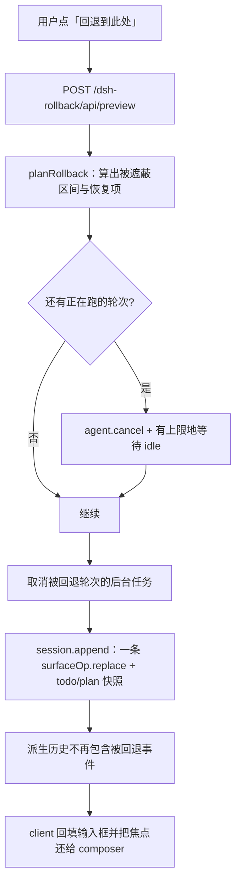

# dsh-rollback

[](LICENSE)
[](https://github.com/deepseek-ai/deepseek-harness)

在 DeepSeek Harness 的对话里**就地回退**到任意一条用户消息。

点一条用户消息旁边的「回退到此处」按钮，这条消息以及它之后的所有内容都会从聊天视图、轨迹视图和模型上下文中消失，消息原文回填到输入框，改完直接重发。

## 为什么是「就地回退」而不是「分叉」

DSH 自带「分叉会话」（`session.fork`）会新建一个会话 ID，旧会话原封不动留在侧边栏里。回退不一样：**同一个会话 ID、同一个标题、同一份历史日志**，只是后面的内容不再参与对话。频繁试错时不需要维护一堆平行会话。

## 用法

1. 悬停到任意一条用户消息上，点它上方动作行里的「回退到此处」按钮。
2. 确认框会告诉你要删除多少条消息、会取消什么，以及这些消息无法恢复。
3. 确认后，该消息及之后的内容消失，消息文字回到输入框（可在设置里关闭回填），键盘焦点也会回到输入框。

回退到第一条用户消息会清空整个对话，聊天区显示空状态页，会话本身保留。

## 行为细节

| 事项 | 行为 |
| --- | --- |
| 删除范围 | 被点的那条用户消息 **及其之后的所有内容** |
| 物理删除 | 否。会话日志只追加，回退通过 *surface replace* 让被遮蔽的事件退出派生历史；磁盘上的原始记录保留，但不再可见、不可搜索、不再进入模型上下文 |
| 界面 | 聊天视图与轨迹视图都不再渲染被回退的轮次 |
| 刷新/重启 | 保持回退后的状态（回退本身就是一次持久化的日志追加） |
| 模型感知 | 无。不回写系统提示，不插入提示性消息 |
| 回退时的会话状态 | 自动停止正在进行的轮次，并清空排队的消息 |
| 后台任务 | 被回退轮次里启动且仍在跑的子代理/后台作业会被取消 |
| 非对话状态 | `todo` 与计划模式会一并回到回退点；**`goal` 不回退**（见「已知限制」）。模型选择、权限/沙箱模式、审批策略、工作目录、agent 预设保持不变 |
| 标题 | 保持原标题不变（清空标题做不到，见「已知限制」） |
| 连续回退 | 支持，每次叠加新的遮蔽记录 |
| 多窗口 | 状态由会话日志驱动，所有窗口/标签页实时一致 |
| 外观 | 确认框、按钮、设置开关全部使用 DSH 主题 token，跟随亮色/暗色主题切换 |
| 界面语言 | 设置卡片文案跟随 DSH 的界面语言（中文 / English）实时切换 |

## 安装

插件是一个标准的 DSH bundle，装进 profile 即可：

```bash
dsh plugin --profile desktop add /path/to/dsh-rollback
```

或在 DSH Web GUI 的插件页里从本地目录安装。安装后重启 DSH。

也可以直接从 GitHub 克隆后安装：

```bash
gh repo clone fu-roc/dsh-rollback
dsh plugin --profile desktop add ./dsh-rollback
```

> npm 上的 `dsh-rollback` 是另一个同名插件（文件修改回滚），本项目尚未发布到 npm。

### 确认插件装好了

装完重启 DSH，打开任意一个已有对话：

- 悬停到一条**用户消息**上，气泡上方出现「回退到此处」按钮；
- 设置页（设置 → 插件）里出现「对话回退」分区，含一个「回退后把消息回填到输入框」开关。

两处任一出现，就说明 host 与 client 两半都加载了。只有按钮没设置项，通常意味着只加载了 client 半（检查 `dsh.bundle.patch`）；只有设置项没按钮，通常是缺 `ui-conversation` 的插槽依赖。

## 演示：回退前 / 回退后

一次回退，四个状态。同一个会话，同一个 ID：

| 步骤 | 动作 | 会话里有什么 |
| --- | --- | --- |
| 1 | 原始状态 | 两轮对话：改配置 → 跑测试 |
| 2 | 第二轮里模型改错了文件 | 日志里多了 3 条事件 |
| 3 | 点第一条用户消息上的「回退到此处」并确认 | 界面立刻只剩空状态页 |
| 4 | 粘贴回填的文字重新发问 | 从第 1 轮的干净上下文继续 |

关键点：**第 3 步之后模型再也看不到第 2 轮**。下一次请求的 `deriveMessages()` 只会返回第 1 轮的内容——不是"让模型忽略"，而是它压根不在上下文里。

## 工作原理



回退不做物理删除：DSH 的会话日志是严格追加写的，插件复用 compaction 同款的原语 `surfaceOp: { op: 'replace' }`，让被遮蔽的事件退出派生历史。日志本身保持完整，所以刷新、重启、多窗口都天然一致。

## 模型体验

**Token 开销。** 常态为零：插件不注册工具、不注入提示词、不改系统提示；回退本身只往日志追加一条 system/message（内容为空，模型看不到）。唯一的持久开销是被遮蔽区间的原始事件仍在磁盘上，但它们不进上下文，也不计 token。

**KV cache。** 回退是追加，不是改写前缀：被保留的历史逐字节不变，下一次请求的可复用前缀因此不受影响。新的请求前缀在回退点之后分叉，原有 cache entry 仍然有效。

## 设置

设置页新增「对话回退」分区，只有一个开关：

- **回退后把消息回填到输入框**（默认开启）
  回退后把被删消息的纯文字放回输入框，方便修改后重发；关闭后不回填文字，但焦点仍会回到输入框。图片与附件不会回填。

## 已知限制

- **不做物理删除。** DSH 的会话日志是严格追加写的（事件 `seq` 就是行号，永不重写），任何「删掉中间几行」的操作都会破坏日志。回退只做逻辑删除。
- **被回退的消息无法恢复。** 没有撤销、没有历史面板、没有导出。这是有意的设计：回退就应该干净。
- **轨迹视图的「请求」面板**按请求列出上下文快照，它不读节点的可见性，可能仍能看到被回退轮次的请求记录。
- **空占位节点。** surface replace 必须插入一个替换节点，插件使用一条空的 `system/message`（模型不会看到它）。某些视图里它可能表现为一个极小的空行。
- **按钮位置。** DSH 的用户消息渲染器只开放了气泡**上方**的链式插槽（`conversation.chat.user.before`），所以按钮显示在气泡上方的动作行里，而不是和复制按钮同一条内联图标行。
- **`goal` 不会随回退恢复。** 目标（goal）的事件折叠要求每次变更都精确递增一个 revision（`next.revision === current.revision + 1`），把回退点之前的旧快照重新追加会破坏这条规则，导致该会话的 goal 服务永久报错。所以回退只处理 `todo` 和计划模式，goal 状态保持回退后的原样。
- **不重置标题。** 原计划「清空标题让它重新自动命名」做不到：DSH 的标题服务拒绝空标题，且重命名会永久 pin 住标题（此后不再自动命名）；绕过它直接写入空标题虽然能通过日志校验，但标题投影的 schema 是 `z.string().min(1).nullable()`，会让会话的投影状态非法。因此回退到第一条时会话保留原标题。
- **前端隐藏依赖事件流的 `rollback-cut` 标记。** 如果 DSH 改变 surface 事件的渲染路径，界面隐藏可能失效；此时**模型层仍然是正确的**（被回退内容不会进入上下文），只是界面会重新显示这些轮次。
- **界面隐藏只基于已加载的事件窗口。** 回退标记从被回退事件自身携带的 `sourceEventSeqs` 推导，不依赖窗口里更早的事件，所以正常分页加载不会漏。但如果一次回退点之后的所有事件都还没被前端加载（例如刚打开一个很长的历史会话、尚未向上翻页），已加载范围内看不到该标记，界面不会提前隐藏——向上翻页加载到该区间后即恢复正常。
- **跨窗口并发回退会被拒绝，但只在本进程内。** 同一会话同时只允许一次回退：第二个窗口会收到「另一个窗口正在回退这个会话」。这个闩锁是进程内的——如果两个 DSH 进程（例如两个桌面实例）指向同一份会话日志，它们之间没有互斥，建议一次只在一个窗口里回退。
- **等待正在运行的轮次有 15 秒上限。** 回退会先 cancel，再最多等 15 秒让当前轮次收尾。若某个工具卡死导致轮次迟迟不结束，回退会在超时后继续执行，并把这次超时写进 DSH 日志——结果仍然正确（遮蔽区间按当前 surface 计算），但那个迟到的步骤可能追加到回退点之后。
- **读取历史事件使用的是已弃用 API。** 计算遮蔽区间需要按区间读取原始事件，而 `Session` 目前只有 `snapshotEvents()` 这一条路径能做到，它已被标记为 `@deprecated`（无替代 API）。DSH 未来移除它时，host 侧需要跟着改。

## 兼容性

- 目标 DSH：`>=0.2.0`（在 `0.2.2-rc.5` 上开发与验证）
- Node.js：`>=20`
- 平台：Web / Desktop GUI（`dsh.client.platform = web`）

## 开发

```bash
node --test          # 14 个用例：区间规划 + 并发闩锁 + 空闲等待
node --check lib/index.js
node --check lib/client.js
```

无构建步骤，lib/ 就是可发布的源码；无运行时依赖，peer 包从 DSH 安装本身解析。

## 许可

MIT
